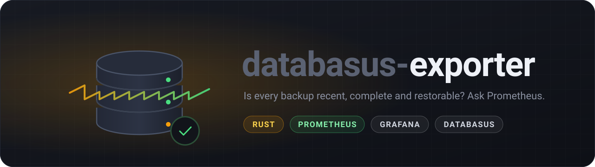

<p align="center">
  
</p>

# databasus-exporter

Prometheus exporter for [Databasus](https://github.com/databasus/databasus).
Databasus has no metrics endpoint of its own, so this reads its REST API and
exposes the state of every database's backups: when the last one ran, whether
it worked, how big it was and whether its restore verification passed.

It is a single static binary (about 3.5 MB image) with no runtime
dependencies.

## Configuration

| Variable             | Default                 |                                   |
|----------------------|-------------------------|-----------------------------------|
| `DATABASUS_URL`      | `http://localhost:4005` | Databasus base URL                |
| `DATABASUS_EMAIL`    | required                | account used to read the API      |
| `DATABASUS_PASSWORD` | required                |                                   |
| `LISTEN_ADDR`        | `0.0.0.0:9810`          |                                   |
| `INTERVAL_SECONDS`   | `30`                    | how often to collect (minimum 5)  |

Collection runs in the background; `/metrics` always answers immediately with
the last result (or `503` until the first collection has finished).
`/healthz` returns `ok`.

### A view-only account

Databasus has no API keys, so the exporter signs in as a user. Give it its own
account with the least access that still works:

1. As an admin, invite the user (`POST /api/v1/users/invite`), then sign it up
   with a password (`POST /api/v1/users/signup`). It gets the `MEMBER` role.
2. Add it to each workspace as `WORKSPACE_VIEWER`
   (`POST /api/v1/workspaces/memberships/<workspace id>/members`). Setting an
   intended workspace in the invite was not enough in Databasus 3.60.

A viewer can read databases, backups and backup settings, and does not get
database passwords back. Note that it can still start a backup or test a
connection; the exporter only ever sends `GET` requests.

## Metrics

All per-database metrics carry `workspace` and `database` labels.

| Metric | |
|---|---|
| `databasus_up` | 1 if the last collection succeeded completely |
| `databasus_scrape_duration_seconds` | how long the last collection took |
| `databasus_collection_timestamp_seconds` | when it finished |
| `databasus_database_info{type}` | one series per database |
| `databasus_database_healthy` | Databasus can reach the database |
| `databasus_backups_enabled` | scheduled backups are on |
| `databasus_backups` | number of backups kept |
| `databasus_backup_last_timestamp_seconds` | start of the latest backup |
| `databasus_backup_last_status{status}` | 1 for the latest backup's status: `IN_PROGRESS`, `COMPLETED`, `FAILED`, `CANCELED` |
| `databasus_backup_last_success_timestamp_seconds` | start of the latest completed backup |
| `databasus_backup_last_success_size_bytes` | its file size |
| `databasus_backup_last_success_raw_size_bytes` | size of the database it covered |
| `databasus_backup_last_success_duration_seconds` | how long it took |
| `databasus_backup_last_verification{status}` | 1 for its restore verification: `NOT_VERIFIED`, `VERIFIED_SUCCESSFUL`, `VERIFICATION_FAILED` |

Status gauges always carry every possible value (0 or 1), so an alert can
match on them without waiting for a series to appear.

### Grafana dashboard

`dashboards/databasus.json` shows, per database, how long ago the last
completed backup ran, the latest status, the restore test result, sizes and
durations, plus a few totals and the exporter's own health. Import it in
Grafana (Dashboards, New, Import) and pick your Prometheus data source; the
workspace and database selectors fill themselves from the metrics.

### Example alerts

```promql
# no completed backup for more than 26 hours
time() - databasus_backup_last_success_timestamp_seconds > 26 * 3600
  and on (database) databasus_backups_enabled == 1

# the latest backup failed
databasus_backup_last_status{status="FAILED"} == 1

# a restore test failed
databasus_backup_last_verification{status="VERIFICATION_FAILED"} == 1
```

## Running

```sh
docker build -t databasus-exporter .
docker run -e DATABASUS_URL=http://databasus:4005 \
  -e DATABASUS_EMAIL=exporter@example.com -e DATABASUS_PASSWORD=... \
  -p 9810:9810 databasus-exporter
```
